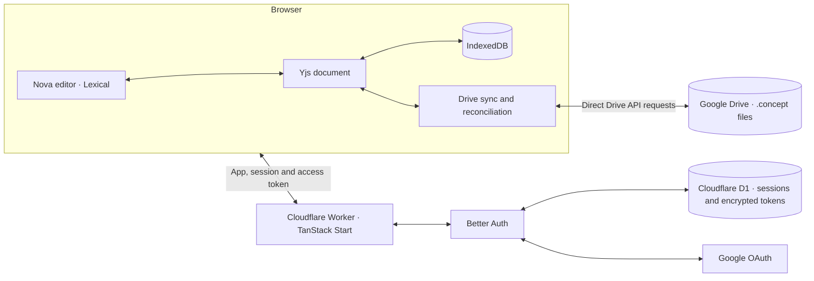

# Concept

Concept is an offline-first document editor built around a simple idea: your documents should be responsive, portable, and inexpensive to serve. It combines a rich-text editor with local storage and optional Google Drive sync, using CRDTs to reconcile changes made independently.


## Contents

- [What you can do](#what-you-can-do)
- [Core ideas](#core-ideas)
- [Architecture](#architecture)
- [Getting started](#getting-started)
- [Google Drive and authentication](#google-drive-and-authentication)
- [Development](#development)
- [Deployment](#deployment)
- [Project structure](#project-structure)

## What you can do

- Write with rich text, headings, lists, checklists, quotes, dividers, a slash menu, and formatting controls.
- Keep documents locally or sync them to Google Drive, including files shared with you.
- Import Markdown, HTML, plain text, and native `.concept` files. Export to Markdown, HTML, plain text, or `.concept`, and print or save as PDF through the browser.
- Customize the editing experience with page settings and light, dark, or system themes.

The native `.concept` format carries a versioned Yjs update, preserving document state for import and export.

## Core ideas

**Low cost per user.** Concept aims to make the cost of serving each user as low as practical. Editing and local persistence happen in the browser; document content is stored in the user's browser and, optionally, their Google Drive. Cloudflare Workers handle the application and authentication rather than proxying every document edit.

**Fewer network requests.** Drive saves are batched after three seconds of inactivity, with a maximum wait of 60 seconds while a document is dirty. Unchanged snapshots are not uploaded. The browser talks directly to Drive, reducing Worker requests for document operations.

**Offline first.** Local documents can be edited without a network connection. Drive-backed documents can also be edited offline when their content is available locally; pending changes sync when connectivity and access return. Browser storage can be cleared or evicted, so Drive sync or an exported copy provides an additional copy.

**Merge changes, don't overwrite them.** Documents use Yjs conflict-free replicated data types (CRDTs). Drive uploads use conditional requests: if the remote file has changed, Concept downloads its state, merges it with local changes, and retries. This supports reconciliation across independently edited copies; it is not a real-time collaboration service.

**Documents can grow beyond text.** Planned dynamic integrations include Mermaid diagrams, Excalidraw drawings, YouTube embeds, and other interactive content. These are directions for the project, not features available in this checkout.

## Architecture



The editor binds Lexical to a Yjs document, which is persisted in IndexedDB. For Drive-backed documents, the sync layer batches changes and stores serialized Yjs state in Drive. It checks for remote changes on focus and when connectivity returns, and retries transient failures with backoff. Drive v2 ETags and `If-Match` protect writes from silently overwriting a newer remote version.

Better Auth keeps sessions and encrypted Google tokens in D1. An HttpOnly session cookie authenticates the access-token endpoint; the browser keeps the access token in memory and makes Drive requests directly. Google Drive permissions determine whether a shared document is editable or read-only.

## Getting started

Prerequisites: Node.js, [pnpm](https://pnpm.io/), and a Cloudflare/Google OAuth configuration for Drive features. The pinned pnpm version is in `package.json`; see `mise.toml` for the project's runtime versions.

```bash
pnpm install
cp .env.example .env
pnpm exec wrangler d1 migrations apply DB --local
pnpm run dev
```

Open [http://localhost:3000](http://localhost:3000). Configure the values in `.env` before using Google sign-in and Drive. Local documents can be used without connecting Drive.

## Google Drive and authentication

Set `BETTER_AUTH_SECRET`, `GOOGLE_CLIENT_ID`, `GOOGLE_CLIENT_SECRET`, and `OAUTH_PROXY_SECRET` in the ignored local `.env` file. See [`.env.example`](.env.example) for the client-side settings. Use independent Better Auth secrets for production and staging; the OAuth proxy secret must match across trusted environments. Public settings and D1 bindings are configured in [`wrangler.jsonc`](wrangler.jsonc).

Register `https://concept.maddock.world/api/auth/callback/google` as the Google OAuth redirect URI for this deployment. [Better Auth OAuth Proxy](https://better-auth.com/docs/plugins/oauth-proxy) routes local and preview callbacks through the production origin. Adjust the origin and trusted origins if deploying your own instance.

Concept requests the `drive.file` scope. Files shared by others or not created by the app need to be selected with Google Picker to grant access:

1. Enable the Google Drive API and Google Picker API in the same Google Cloud project.
2. Register JavaScript origins for local development and production in the OAuth client settings.
3. Create an API key restricted to the Google Picker API. Add website restrictions for `http://localhost:3000/*`, your production origin, and `https://docs.google.com/*` for the Picker iframe.
4. Set `VITE_GOOGLE_PICKER_API_KEY` and `VITE_GOOGLE_PICKER_APP_ID` to the API key and Google Cloud project number. The app ID can instead be inferred from `VITE_GOOGLE_CLIENT_ID`.
5. For GitHub Actions, configure the `VITE_GOOGLE_PICKER_API_KEY` repository secret and `VITE_GOOGLE_PICKER_APP_ID` repository variable. These are build-time values; a Worker runtime secret alone does not configure Picker.

Optional analytics can be enabled with `VITE_POSTHOG_KEY` and, for a different region or self-hosted instance, `VITE_POSTHOG_HOST`.

## Development

```bash
pnpm run check       # formatting
pnpm run lint        # linting
pnpm run typecheck   # TypeScript
pnpm run test        # tests
pnpm run build       # production build
pnpm run validate    # full validation, including generated files
```

Routes are file-based under `src/routes`. When changing the Better Auth schema, generate an additional migration with a new filename:

```bash
pnpm exec node scripts/generate-auth-migration.ts migrations/0002_auth.sql
```

## Deployment

The [GitHub Actions pipeline](.github/workflows/ci.yml) runs on pull requests and pushes to `master`, and can also be started manually. It checks formatting, linting, generated routes and Worker types, TypeScript, tests, and the production build. It also audits dependencies and scans for secrets; CodeQL runs when enabled for the repository. Deployments wait for the required checks and use the build artifact produced by CI.

- **Preview:** Eligible pull requests from the same repository, excluding Dependabot, deploy to a Cloudflare Workers preview. CI applies migrations to the shared `concept-staging` D1 database and posts the preview URL on the PR. Preview URLs are public.
- **Production:** A push to `master` applies migrations to the `concept` D1 database and deploys to Cloudflare Workers. Production deployments run sequentially.

Preview and production use separate D1 databases, while all previews share the staging database. The OAuth proxy routes authentication callbacks through the production origin.

For a manual production deployment, configure the required Cloudflare secrets, then run:

```bash
pnpm exec wrangler d1 migrations apply DB --remote
pnpm run deploy
```

## Project structure

- `src/components/nova/` — editor and its plugins
- `src/lib/documents/` — document storage, import/export, Drive, and sync
- `src/routes/` — application routes and server endpoints
- `src/lib/auth.server.ts` — authentication configuration
- `migrations/` — D1 schema migrations
- `wrangler.jsonc` — Worker bindings and deployment configuration
