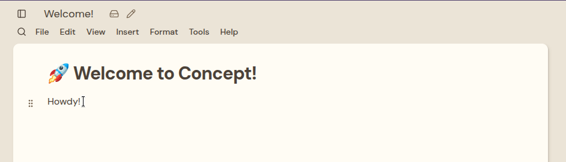
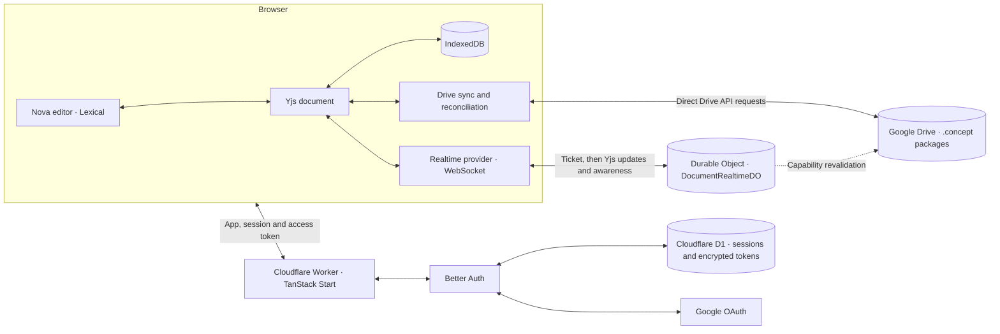

# Concept

Concept is an offline-first document editor built around a simple idea: your documents should be responsive, portable, and inexpensive to serve. It combines a rich-text editor with local storage, optional Google Drive sync, and an optional live collaboration channel, using CRDTs to reconcile changes made independently.

Concept is pre-alpha: the document format may change before 1.0, so export copies of anything you care about.



## Contents

- [What you can do](#what-you-can-do)
- [Core ideas](#core-ideas)
- [Architecture](#architecture)
- [Getting started](#getting-started)
- [Google Drive and authentication](#google-drive-and-authentication)
- [Development](#development)
- [Deployment](#deployment)
- [Versioning and releases](#versioning-and-releases)
- [Project structure](#project-structure)

## What you can do

- Write with rich text, headings, lists, checklists, quotes, dividers, a slash menu, and formatting controls. Press Ctrl/Cmd+/ to search every menu action.
- Insert images by file picker, paste, or drag and drop. Images are stored as content-addressed assets that survive reload, Drive sync, and `.concept` export/import.
- Keep documents locally or sync them to Google Drive, including files shared with you and files in shared drives.
- Open and create documents from Google Drive’s “Open with” and “New” menus.
- Edit Drive documents together in real time: see other people's cursors and presence, and follow a collaborator to their caret. Live collaboration can be switched off per user; changes then sync through Drive and reconcile automatically.
- Import Markdown, HTML (including embedded images), plain text, and native `.concept` files. Export to Markdown (images become alt text), HTML (images inlined), plain text, or `.concept`, and print or save as PDF through the browser.
- Switch between a continuous pageless canvas and paged paper layouts (A4, Letter, and more; portrait or landscape; custom sizes and margins). Pages split automatically, and you can insert manual page breaks. Page setup travels with the document through Yjs, so it syncs to Drive and collaborators and appears in File > Details.
- Customize the editing experience with app appearance (light, dark, or system) and per-document themes — tonal color themes and scene backgrounds that travel with the document.
- Mark Drive documents "Available offline" to keep their content and assets cached in the browser.

The native `.concept` format is a versioned ZIP package: a manifest, a Yjs update, and content-addressed binary assets. Legacy single-update `.concept` files remain readable.

## Core ideas

**Low cost per user.** Concept aims to make the cost of serving each user as low as practical. Editing and local persistence happen in the browser; document content is stored in the user's browser and, optionally, their Google Drive. Cloudflare Workers handle the application and authentication and relay live collaboration traffic through a Durable Object, but they never store or acknowledge document edits — Drive remains the only durable store.

**Fewer network requests.** Drive saves are batched after three seconds of inactivity, with a maximum wait of 60 seconds while a document is dirty. Unchanged snapshots are not uploaded. The browser talks directly to Drive, reducing Worker requests for document operations.

**Offline first.** Local documents can be edited without a network connection. Drive-backed documents can also be edited offline when their content is available locally; pending changes sync when connectivity and access return. Browser storage can be cleared or evicted, so Drive sync or an exported copy provides an additional copy.

**Merge changes, don't overwrite them.** Documents use Yjs conflict-free replicated data types (CRDTs). Drive uploads use conditional requests: if the remote file has changed, Concept downloads its state, merges it with local changes, and retries. Open Drive documents can also join a live collaboration channel that relays Yjs updates and presence; if that channel is unavailable or turned off, Drive reconciliation alone keeps copies consistent.

**Documents can grow beyond text.** Documents already embed images. Further dynamic blocks such as Mermaid diagrams, Excalidraw drawings, and YouTube embeds are directions for the project, not features available in this checkout.

## Architecture



The editor binds Lexical to a Yjs document, which is persisted in IndexedDB. For Drive-backed documents, the sync layer batches changes and stores serialized Yjs state in Drive. It checks for remote changes on focus and when connectivity returns, and retries transient failures with backoff. Drive v2 ETags and `If-Match` protect writes from silently overwriting a newer remote version.

For Drive documents with live collaboration enabled, the browser obtains a short-lived ticket from `POST /api/realtime/ticket` — the Worker checks the session cookie and the user's Drive capabilities, then signs an HMAC ticket — and opens a WebSocket to `GET /api/realtime/socket`. That request is routed to one Durable Object per Drive file, which relays Yjs updates and awareness between admitted clients over hibernated WebSockets. The object revalidates each user's Drive capabilities on an alarm (every 60 seconds while the room is active, backing off to 15 minutes when idle), drops update messages from users who lost edit rights, and never writes to Drive. If the socket is unavailable, editing falls back to the Drive-only path.

Better Auth keeps sessions and encrypted Google tokens in D1. An HttpOnly session cookie authenticates the access-token endpoint; the browser keeps the access token in memory and makes Drive requests directly. Google Drive permissions determine whether a shared document is editable or read-only, and a header indicator shows the current user's view/edit/comment rights, who else is online, and a switch to turn live collaboration off.

## Getting started

Prerequisites: Node.js (CI uses Node 24), [pnpm](https://pnpm.io/), and a Google Cloud OAuth client plus Drive/Picker API key for Drive features. The pinned pnpm version is in `package.json`; see `mise.toml` for the project's runtime versions. Durable Object migrations are applied automatically by `wrangler dev` and `wrangler deploy`; only D1 migrations need an explicit command.

```bash
pnpm install
cp .env.example .env
pnpm exec wrangler d1 migrations apply DB --local
pnpm run dev
```

Open [http://localhost:3000](http://localhost:3000). Configure the values in `.env` before using Google sign-in and Drive. Local documents can be used without connecting Drive. `.env.example` includes `BETTER_AUTH_URL` and the Google Picker key/app-ID pair; without the Picker values you can still create and sync Drive files, but cannot open files you did not create, including files shared with you.

## Google Drive and authentication

Set `BETTER_AUTH_SECRET`, `GOOGLE_CLIENT_ID`, `GOOGLE_CLIENT_SECRET`, `OAUTH_PROXY_SECRET`, and `BETTER_AUTH_URL` in the ignored local `.env` file; `.env.example` also lists the client-side `VITE_GOOGLE_CLIENT_ID`, `VITE_GOOGLE_PICKER_API_KEY`, and `VITE_GOOGLE_PICKER_APP_ID`. Use independent Better Auth secrets for production and staging; the OAuth proxy secret must match across trusted environments. Public settings and D1 bindings are configured in [`wrangler.jsonc`](wrangler.jsonc).

Register `<your-origin>/api/auth/callback/google` as the Google OAuth redirect URI — for this deployment, `https://concept.maddock.world/api/auth/callback/google`. The callback is derived from the Better Auth base URL. [Better Auth OAuth Proxy](https://better-auth.com/docs/plugins/oauth-proxy) routes local and preview callbacks through the production origin. Adjust the origin and trusted origins if deploying your own instance.

Concept requests the `drive.file` and `drive.install` scopes. `drive.file` limits access to files the app created or the user selected; `drive.install` lets Concept appear in Drive’s “Open with” and “New” menus. Add both scopes to the OAuth consent screen configuration before deploying; Google rejects authorization requests for scopes that are not configured. Files shared with you, in shared drives, or not created by the app must be selected with Google Picker to grant access:

1. Enable the Google Drive API and Google Picker API in the same Google Cloud project.
2. Register JavaScript origins for local development and production in the OAuth client settings.
3. Create an API key restricted to the Google Picker API. Add website restrictions for `http://localhost:3000/*`, your production origin, and `https://docs.google.com/*` for the Picker iframe.
4. Set `VITE_GOOGLE_PICKER_API_KEY` and `VITE_GOOGLE_PICKER_APP_ID` to the API key and Google Cloud project number. The app ID may be omitted and is inferred from the numeric prefix of `VITE_GOOGLE_CLIENT_ID`.
5. For GitHub Actions, configure the `VITE_GOOGLE_PICKER_API_KEY` repository secret and `VITE_GOOGLE_PICKER_APP_ID` repository variable. These are build-time values; a Worker runtime secret alone does not configure Picker.

### Drive UI integration

Concept handles Drive’s “Open with” and “New” menu entries at `/open` and `/new`. Configure them under **Google Drive API → Drive UI integration** in the same Google Cloud project:

- **Open URL:** `https://<your-origin>/open`
- **New URL:** `https://<your-origin>/new`
- **Default MIME types:** `application/vnd.concept+zip`, `application/vnd.concept+json`
- **Default file extension:** `concept`
- Enable **Creating files** to show Concept in Drive’s “New” menu, and **Shared drives support** if the menus should be available there.

Drive appends a URL-encoded JSON `state` parameter to both URLs. `/open` reads the file IDs and resource keys, checks Drive access, and opens the document. `/new` creates an empty `.concept` package in the selected folder. Drive requires a fully qualified domain name for these URLs, so test them on a deployed preview or production origin rather than `localhost`.

Optional analytics can be enabled with `VITE_POSTHOG_KEY` and, for a different region or self-hosted instance, `VITE_POSTHOG_HOST`.

## Development

```bash
pnpm run check       # formatting
pnpm run lint        # linting
pnpm run typecheck   # TypeScript
pnpm run test        # tests
pnpm run build       # production build
pnpm run validate    # full validation, including generated files
```

`pnpm run validate` runs formatting, route-tree sync (`check:routes`), Worker type sync (`check:types`), lint, typecheck, tests, and build. `pnpm run test` runs Vitest with a `node` project (server, realtime, and package tests) and a `dom` project (jsdom component tests).

Routes are file-based under `src/routes`. When changing the Better Auth schema, generate the next migration — the script refuses to overwrite an existing file:

```bash
pnpm exec node scripts/generate-auth-migration.ts migrations/0002_auth.sql
```

## Deployment

The [GitHub Actions pipeline](.github/workflows/ci.yml) runs on pull requests and pushes to `master`, and can also be started manually. It checks formatting, linting, generated routes and Worker types, TypeScript, tests, and the production build. It also audits dependencies, scans for secrets with Gitleaks, and runs CodeQL when the repository is public or the `ENABLE_CODEQL` repository variable is set. Production deployments run from the [release workflow](.github/workflows/release.yml) instead of every `master` push. A separate workflow deletes the preview Worker when a pull request closes.

- **Preview:** Eligible pull requests from the same repository, excluding Dependabot, deploy to a Cloudflare Workers preview. CI applies D1 migrations to the shared `concept-staging` database (via `wrangler.preview-migrations.jsonc`), deploys a `pr-<number>` Worker, and posts the preview URL on the PR. Preview URLs are public.
- **Production:** Publishing a release applies D1 migrations to the `concept` database and deploys the built Worker with serialized production deployments. Pushes to `master` only run CI; they do not deploy.

Preview and production use separate D1 databases, while all previews share the staging database. Durable Object migrations are applied by `wrangler dev` and `wrangler deploy` from the `migrations` block in `wrangler.jsonc`. The OAuth proxy routes authentication callbacks through the production origin.

To disable live collaboration deployment-wide, set the Worker variable `REALTIME_ENABLED` to `false`. The ticket endpoint then refuses issuance and clients fall back to Drive-only sync.

For a manual production deployment, configure the required Worker secrets (`BETTER_AUTH_SECRET`, `GOOGLE_CLIENT_SECRET`, `OAUTH_PROXY_SECRET`) and the build-time `VITE_GOOGLE_PICKER_*` values, then run:

```bash
pnpm exec wrangler d1 migrations apply DB --remote
pnpm run deploy
```

## Versioning and releases

Versions follow [Semantic Versioning](https://semver.org/) and are derived from [Conventional Commits](https://www.conventionalcommits.org/) by [release-please](https://github.com/googleapis/release-please). `package.json` holds the current version; release-please updates it together with `CHANGELOG.md`, the `v<version>` Git tag, and the GitHub Release in a single release pull request. `v0.1.0` is the baseline; each next release is derived from commits since the latest tag.

The release flow:

1. Push conventional commits (`feat:`, `fix:`, and so on) to `master`. release-please runs on every master push, whether it is a merge commit, squash merge, or direct commit. CI validates the push but does not deploy.
2. release-please opens or updates a release pull request that bumps the version and adds the changelog entries.
3. Merge the release pull request. release-please creates the tag and GitHub Release, and the `Release` workflow deploys that tag to production.

| Commit                                                                       | Release pull request | Version bump                |
| ---------------------------------------------------------------------------- | -------------------- | --------------------------- |
| `feat:`                                                                      | yes                  | minor                       |
| `fix:`, `perf:`, `revert:`, `deps:`                                          | yes                  | patch                       |
| `feat!:`, `BREAKING CHANGE:`                                                 | yes                  | major (minor while pre-1.0) |
| `chore:`, `docs:`, `test:`, `ci:`, `style:`, `refactor:`, `build:`, `clean:` | no                   | none                        |

With a merge commit, release-please parses each commit in the PR; with a squash merge, it parses only the PR title. Do not edit `package.json` `version`, `.release-please-manifest.json`, or `CHANGELOG.md` by hand — release-please owns them.

To force a specific version, add a `Release-As: <version>` footer to a commit, for example `Release-As: 1.0.0`. While the project is pre-1.0, breaking changes bump the minor version instead of the major version.

The built app reads `version` from `package.json` at build time and shows it in the workspace sidebar. It also bundles the generated changelog and shows it from **Help → What's new**; a **What's new?** button appears in the workspace header when the running version differs from the last version the user acknowledged. To redeploy an existing release, run the **Deploy** workflow with a tag such as `v0.1.0`.

release-please uses the repository `GITHUB_TOKEN` by default, which does not trigger CI on its own pull requests. Add a `RELEASE_PLEASE_TOKEN` secret containing a personal access token with `contents: write` and `pull-requests: write` if release pull requests should run the normal CI checks. The release is deployed by the same workflow, so the token is not required for deployment.

## Project structure

- `worker.ts` — Worker entry; also exports the realtime Durable Object
- `src/worker/` — `DocumentRealtimeDO`, the per-file realtime room adapter
- `src/components/nova/` — editor and its plugins
- `src/components/documents/` — workspace, navigation, status, theme, and page setup UI
- `src/lib/documents/` — document storage, import/export, Drive, and sync
- `src/lib/documents/realtime/` — ticket, WebSocket provider, room, and awareness
- `src/lib/documents/drive/` — Drive API, auth, and Google Picker
- `src/lib/auth.server.ts` — authentication configuration
- `src/routes/` — application routes and server endpoints
- `src/hooks/` — document and mobile hooks
- `migrations/` — D1 schema migrations
- `scripts/` — route-tree and auth-migration generators
- `wrangler.jsonc` — Worker bindings and deployment configuration
- `wrangler.preview-migrations.jsonc` — preview D1 configuration
- `design/` — feature design notes
- `docs/reviews/` — subsystem code reviews
